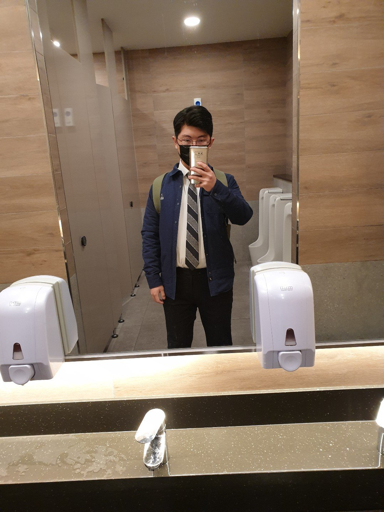
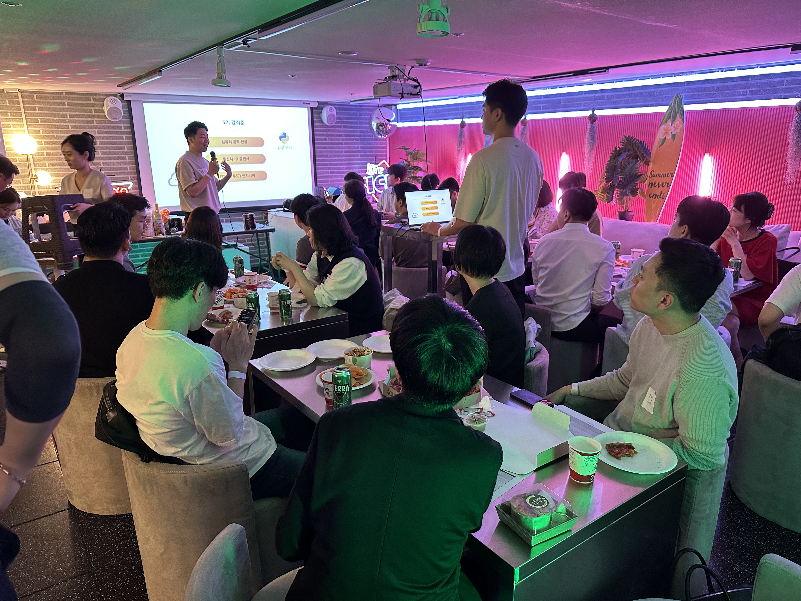

1년 3개월, 3년 10개월 동안 프리랜서를 해왔다. 총 5년 1개월이 흘러갔다. 처음에는 외주가 많아 시작이 좋았다. 코로나 특수였기 때문이다. 이제는 과외를 하고 외주를 해서 먹고 살고있다. 오늘은 5년 1개월 간의 여정에 대한 회고를 할거다.

## 1. 동굴 안에서 나오지 않던 나

~~화장실에서 찍은 사진이라 불편하면 미안하다. 사진이 없었다.~~ 병원에서 퇴원하면서 나는 한 동안 집에서 나오질 않았다. 사회에서의 내 자리가 없다고 생각했기 때문이다. 그래도 온라인에는 내 소개를 올려놨고 책을 쓰게 되었다. 그게 내 2번 째 사회생활의 시작을 의미했다.

## 2. 코로나 특수

중국에서 코로나가 발병했다. 전염성이 있고 죽을 수 있다고 언론은 떠들었다. 그런데 웬일 오프라인이 망하고 온라인이 살아나기 시작했다. 크몽으로 의뢰가 쏟아져 들어왔다. 사람들이 집밖으로 못나가니 오프라인에서 온라인으로 돈이 흐르기 시작했던거다.

- 인스마스터(사내 보험 관리자 사이트) 개발
- MRT(거래소 사이트) 개발
- 리스팅(이커머스 관리자 사이트) 개발
- 커스랜드(부동산 매물 찾기 사이트) 개발
- 제이엠파워(마스크 판매 및 관리자 사이트) 개발
- 가루다(공부 SNS 앱 서버) 개발

이때 나는 월에 천만원 정도 3번 반복해 벌었다. 그동안 월급을 모아둔 것도 있었지만 외주가 자산형성에 매우 큰 역할을 해줬다. 기분 좋은 시작이였다.

## 3. 욕심을 부렸다

득이양양해진 나는 초기 스타트업 공고를 유심히 지켜보고 있었다. 취업하고 싶은 욕망은 꺼지질 않았던 것이였다. 웬일 프로그라운드라는 회사에서 나에게 연락을 해왔다. 먼저 연락을 주신게 너무 감동 받아서 면접을 보고 입사를 하게 되었다.

모난 사람 없이 회사는 목표를 향해 달려갔다. 인턴이 선린 후배라 많이 반가웠다. 꼰대가 된 나는 동아리와 과를 물어보고 열심히 꼰대짓을 했다. 그래도 서버를 좀 가르쳐줬다. 나는 테크리더를 목표로 동료들과 로켓을 만들기 시작했다. 하지만 한계가 있었고 우리는 위기에 직면했다. 그러다 투자자측에서 블록체인을 연동해 달리기 리워드 앱을 만들자고 제안을 주셨고 우리는 또 다시 달렸고 다른 업체들과 경쟁을 하고 1등을 사수했다. 이때 나는 많은 기여를 했다고 생각해 스스로 자랑스러웠다. 하지만 1년을 못가 아프기 시작했고 팀장과 마찰이 생겼다. 엎친데 덮친격이라 그만뒀다.

지금 생각해보면 이때가 나의 최전성기였던것 같다. 이 시간은 첫 프리랜서를 하고 잠깐의 1년을 보냈다고 생각한다.

## 4. 창업 찍먹

23년도 1월말 퇴사 후 원룸 계약이 끝나지 않아 관악구에 한 동안 있었다. 그러다 창업 부트캠프 창을 발견하고 스타트업 경험을 살려 창업 찍먹을 해보기로 했다.

1차 미션에서는 10만원으로 얼만큼 불릴 수 있는지가 미션이였다. 나는 막내 포지션이였고 네트워킹 파티를 주최해 성공적으로 미션을 수행했다. 이 때 팀원 분들이 다들 뛰어나신 분들이라 진행과 준비를 잘해주셨다.

2차에서는 실제 팀을 만드는 미션이였다. 얼떨결에 팀장이 되었고 나 포함 3명과 전직장 동료 한분이 서포트를 해주셨다. 그러다 고민톡톡이라는 앱을 개발하고 아이디어를 PPT화 해서 VC 앞에서 팀장을 맡아 발표를 했었다. 당일 날 발표 연습은 잘했냐고 물어보셔서 그렇다고 했다. 발표는 잘끝냈다.

페르소나를 정의하는 법과 문제 해결을 하는 과정에서 많이 배웠다. 하지만 이 때도 몸이 자주 아파 속상했다. 이 시간을 따로 정리해서 링크드인에 올렸는데 참 의미 있는 시간이였다. 한 팀원 분은 결혼하셔서 최근에 식장을 갔다오기도 했다. 잘사셨으면 한다.

## 5. 인생 그래프가 이상하다

잘풀릴 때도 있었고 나락을 가기도 했었고 멘탈이 쿠쿠다스가 되어 갔다. 엄마랑 정말 많은 이야기를 했고 내가 너무 아파하자 구로에 오피스텔 매매를 알아봐주셨다. 관악구는 머니깐 집 근처에서 살면서 챙겨준다고 하셨다. 나락에 빠져 허우적 되던 나에게는 기회라 생각했고 국민은행에서 대출을 받아 현금을 합쳐 매매를 했다. 지금의 내가 있을 수 있게 보금자리가 되어 줬다.

## 6. 과외

과외는 회사를 나오자마자 꾸준히 홍보했던 일이였는데 숨고를 알게 되었고 포텐이 터져 6명 정도 과외를 가르칠 수 있었다. 숨고 포함 총 15명정도 가르친것 같다. 파이썬, 자바스크립트, C언어를 가르쳤고 이는 내가 학점은행제로 학사에 도전하고 정보처리기사를 준비하게 되었으며 NCS 강사에 도전할 수 있는 생각의 시발점이 되었다.

이제 소개는 이렇게 하고 있다.

👋 파이썬 개발자 | 저자 | 강사

● 파이썬으로 글로벌 서비스 백엔드 개발 · 250만 유저 관리

● 타입스크립트로 블록체인 전문성(KAIA, TON) 보유

● 프리랜서로 다수 프로젝트 진행, 크몽 18건 평점 5.0

● 한빛미디어 『핸즈온 FastAPI』, 『처음 배우는 플라스크 웹 프로그래밍』 저자

● 인프런 「FastAPI 더 잘써먹기」, 「파이썬 자료구조와 알고리즘으로 만드는 미니 게임」 강의

● 고려대 데이터 청년 캠퍼스 특강 · 전남대 블록체인 멘토

● 프로그래밍 과외 15명 이상, 숨고 6건 평점 5.0

## 7. 결론

세상은 나를 책임져 주지 않는다 오히려 눈뜨고 코베이는 세상이다. 직장 3년 프리랜서 5년 경력의 나는 그 동안의 경험과 능력으로 NCS 강사라는 또 다른 도전을 하게 되었다. 세상이 나를 억까하면 열심히 울고 다시 툭툭 일어나서 자기 페이스로 나아가면 된다. 그게 나의 전부였던 것 같다. 나는 오늘도 프리랜서를 하고 있다.
